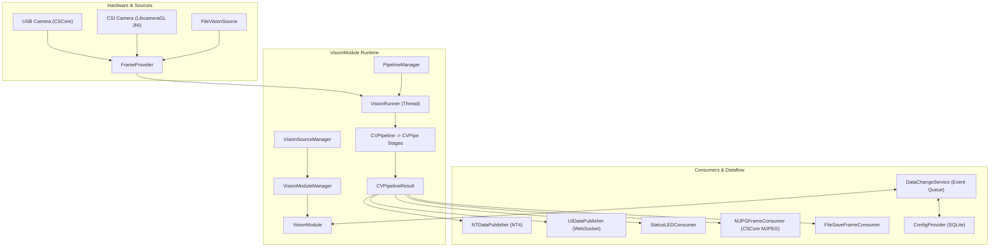

# photon-core - Technical Plan (Migrated)

## Current Architecture

`photon-core` follows a modular, event-driven, pipeline-based architecture split into two primary package trees: `org.photonvision.common` (infrastructure, configuration, dataflow, hardware, networking, logging) and `org.photonvision.vision` (cameras, frame providers/consumers, OpenCV wrappers, pipes, pipelines, target math, and runtime execution processes).

### Key Architectural Patterns
1. **Per-Camera Isolation (`VisionModule`)**: Each active camera runs in its own `VisionModule` with a dedicated `VisionRunner` thread for frame capture and `CVPipeline` execution, plus a dedicated `StreamRunnable` thread for rendering 2D/3D overlays (`OutputStreamPipeline`), MJPEG streaming, and UI/LED publishing so slow stream encoding does not block NetworkTables publishing.
2. **Composable Pipe Pattern (`CVPipeline` & `CVPipe<I, O, P>`)**: Pipelines are deterministic DAGs/sequences of `CVPipe` stages configured via `setPipeParamsImpl()`. Each pipe's execution time is tracked in `PipelineProfiler`.
3. **Explicit Native Memory Lifecycle (`Releasable` & `CVMat`)**: Because Java's garbage collector is unaware of native OpenCV `Mat` heap pressure, `CVMat`, `Frame`, `Contour`, `TrackedTarget`, `CVPipelineResult`, and `CVPipeline` implement `Releasable` for deterministic `release()` calls at the end of every frame loop.
4. **Pub/Sub Event Bus (`DataChangeService`)**: Decouples WebSocket UI mutations, NetworkTables callbacks, and vision module parameter updates via a single-threaded `LinkedBlockingQueue<DataChangeEvent>` dispatcher.
5. **SQLite JSON Document Store (`ConfigProvider`)**: Combines relational schema versioning (`MigrationManager`, `user_version` pragma) with JSON serialization (via `avaje-jsonb`) for flexible camera and pipeline settings storage in `photon.sqlite`.

## Technology Stack

| Layer | Technology / Library | Version / Details |
| :--- | :--- | :--- |
| **Language & Build** | Java (UTF-8, Gradle 9.4.1) | Spotless (`googleJavaFormat`), WPILib `WpilibTools` & `GradleJni` plugins |
| **Robotics & Messaging** | WPILib (`ntcore`, `cscore`, `wpimath`, `wpiutil`, `wpinet`, `apriltag`, `fields`, `hal`, `datalog`) | `2027.0.0-alpha-8` |
| **Computer Vision** | WPILib OpenCV | `2027-4.13.0-4` |
| **Camera & Calibration JNI** | `photon-libcamera-gl-driver`, `photon-mrcal` | Libcamera GL (`v2027.0.0-alpha-1`), `mrcal` (`dev-v2027.0.2-12-gdc31176`) |
| **Neural Network Inference JNI** | `rknn_jni` (Rockchip NPU), `tflite_jni` (TensorFlow Lite) | `rknnVersion = v2027.0.0`, `tfliteVersion = v2027.0.2-alpha-1` |
| **Serialization** | Avaje Jsonb (`io.avaje.jsonb`), Protobuf / Quickbuf, WPILib Struct / Packet (`photon-targeting`) | `avajeJsonbVersion = 3.15`, `quickbufVersion = 1.4` |
| **Persistence & Archives** | SQLite JDBC (`org.xerial:sqlite-jdbc`), ZeroTurnaround ZIP (`zt-zip`) | SQLite `3.41.0.0`, `zt-zip 1.14` |
| **Hardware & OS Metrics** | `diozero-core` (GPIO/PWM), `oshi-core` (System/CPU/RAM metrics) | `diozero 1.4.1`, `oshi 7.4.0` |
| **Testing** | JUnit 5, `junit-pioneer` | `2.2.0` |

## Component Map

| Package / Directory | Responsibility |
| :--- | :--- |
| [`common/configuration`](file:///home/rose/Documents/workspace_local/photonvision/photon-core/src/main/java/org/photonvision/common/configuration) | `ConfigProvider` SQLite persistence, `PhotonConfiguration`, `CameraConfiguration`, `NetworkConfig`, `HardwareConfig`, `PathManager`, `NeuralNetworkModelManager`, and schema migrations (`migrations/`). |
| [`common/dataflow`](file:///home/rose/Documents/workspace_local/photonvision/photon-core/src/main/java/org/photonvision/common/dataflow) | `DataChangeService` pub/sub event bus, `CVPipelineResultConsumer` interface, `networktables/` (`NTDataPublisher`, `NetworkTablesManager`, `TimeSyncManager`, `NTDriverStation`), `websocket/` (`UIDataPublisher` & UI DTOs), and `statusLEDs/`. |
| [`common/hardware`](file:///home/rose/Documents/workspace_local/photonvision/photon-core/src/main/java/org/photonvision/common/hardware) | `HardwareManager`, `Platform` / `PiVersion` detection, `VisionLED`, `gpio/` (`diozero` custom adapters), `statusLED/`, and `metrics/` (`SystemMonitor` implementations for Raspberry Pi, RK3588, QCS6490, Windows). |
| [`common/logging`](file:///home/rose/Documents/workspace_local/photonvision/photon-core/src/main/java/org/photonvision/common/logging) | Custom `Logger`, `LogGroup`, `LogLevel`, `KernelLogLogger` (`dmesg` tailing), and `PvCSCoreLogger`. |
| [`common/networking`](file:///home/rose/Documents/workspace_local/photonvision/photon-core/src/main/java/org/photonvision/common/networking) | `NetworkManager`, `NetworkingCommands`, and `NetworkUtils` for querying interfaces and configuring DHCP/Static IPs via `nmcli`. |
| [`common/util`](file:///home/rose/Documents/workspace_local/photonvision/photon-core/src/main/java/org/photonvision/common/util) | `TimedTaskManager`, `ShellExec`, `SerializationUtils`, `MathUtils`, `ColorHelper`, `file/` utilities, and `numbers/` tuple types. |
| [`vision/apriltag`](file:///home/rose/Documents/workspace_local/photonvision/photon-core/src/main/java/org/photonvision/vision/apriltag) & [`vision/aruco`](file:///home/rose/Documents/workspace_local/photonvision/photon-core/src/main/java/org/photonvision/vision/aruco) | `AprilTagFamily` definitions and `PhotonArucoDetector` / `ArucoDetectionResult` wrappers around OpenCV ArUco detection. |
| [`vision/calibration`](file:///home/rose/Documents/workspace_local/photonvision/photon-core/src/main/java/org/photonvision/vision/calibration) | `CameraCalibrationCoefficients`, `BoardObservation`, `CameraLensModel`, `JsonMatOfDouble`, and UI calibration DTOs. |
| [`vision/camera`](file:///home/rose/Documents/workspace_local/photonvision/photon-core/src/main/java/org/photonvision/vision/camera) | `PVCameraInfo`, `CameraQuirk`, `QuirkyCamera`, `FileVisionSource`, `csi/` (`LibcameraGpuSource`, `LibcameraGpuSettables`), and `USBCameras/` (`USBCameraSource` and sensor-specific settables). |
| [`vision/frame`](file:///home/rose/Documents/workspace_local/photonvision/photon-core/src/main/java/org/photonvision/vision/frame) | `Frame`, `FrameProvider`, `FrameStaticProperties`, `provider/` (`USBFrameProvider`, `LibcameraGpuFrameProvider`, `FileFrameProvider`, `CpuImageProcessor`), and `consumer/` (`MJPGFrameConsumer`, `FileSaveFrameConsumer`). |
| [`vision/objects`](file:///home/rose/Documents/workspace_local/photonvision/photon-core/src/main/java/org/photonvision/vision/objects) | `Model`, `ObjectDetector`, `Letterbox`, `RknnModel` / `RknnObjectDetector`, `TFLiteModel` / `TFLiteObjectDetector`, and `NullModel`. |
| [`vision/opencv`](file:///home/rose/Documents/workspace_local/photonvision/photon-core/src/main/java/org/photonvision/vision/opencv) | `CVMat`, `Contour`, `CVShape`, `Releasable`, `DualOffsetValues`, and rotation/flip/grouping/sorting enums. |
| [`vision/pipe`](file:///home/rose/Documents/workspace_local/photonvision/photon-core/src/main/java/org/photonvision/vision/pipe) | `CVPipe`, `MutatingPipe`, and 37 concrete image-processing pipes in `impl/` (HSV, contours, PnP, AprilTag, ArUco, calibration, object detection, drawing). |
| [`vision/pipeline`](file:///home/rose/Documents/workspace_local/photonvision/photon-core/src/main/java/org/photonvision/vision/pipeline) | `CVPipeline`, concrete pipelines (`AprilTagPipeline`, `ArucoPipeline`, `ReflectivePipeline`, `ColoredShapePipeline`, `ObjectDetectionPipeline`, `Calibrate3dPipeline`, `DriverModePipeline`, `FocusPipeline`, `OutputStreamPipeline`), settings classes, and `result/` containers. |
| [`vision/processes`](file:///home/rose/Documents/workspace_local/photonvision/photon-core/src/main/java/org/photonvision/vision/processes) | `VisionSourceManager`, `VisionModuleManager`, `VisionModule`, `VisionRunner`, `PipelineManager`, `VisionSource`, `VisionSourceSettables`, and `VisionModuleChangeSubscriber`. |
| [`vision/target`](file:///home/rose/Documents/workspace_local/photonvision/photon-core/src/main/java/org/photonvision/vision/target) | `TrackedTarget`, `PotentialTarget`, `TargetModel`, `TargetCalculations`, and offset/orientation enums. |
