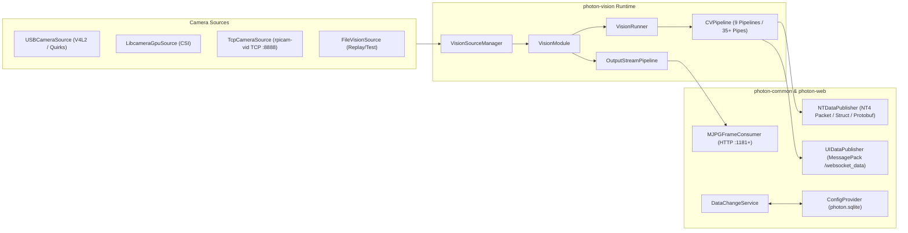

# `fast-photon-core` — Pure-Rust PhotonVision Core Engine

`fast-photon-core` is a high-throughput, memory-safe Rust migration of PhotonVision's `photon-core` (including `photon-targeting` wire serialization and `photon-server` embedded HTTP/WebSocket/MJPEG endpoints). It is designed as a drop-in, zero-GC-pause replacement that maintains 100% database, NetworkTables v4, and WebSocket UI compatibility with existing PhotonVision deployments.

---

## 1. Architecture & Workspace Layout

`fast-photon-core` is structured as a multi-crate Cargo workspace so pure-Rust data, database, and networking tests compile in seconds while isolating computer vision and hardware abstraction modules:

```text
fast-photon-core/
├── .cargo/
│   └── config.toml                   # Cargo target config & aliases for NVIDIA Jetson Orin Nano (Cortex-A78AE)
├── Cargo.toml                        # Workspace manifest, feature flags & lint rules
├── Cross.toml                        # Cross-compilation container settings for aarch64-unknown-linux-gnu
├── CHANGE.LOG                        # Detailed release and feature changelog
├── CHANGELOG.md                      # Markdown changelog
├── rustfmt.toml                      # Standard Rust formatting configuration
├── scripts/
│   └── build-jetson-orin-nano.sh     # Automated native & cross-compile build script for Jetson Orin Nano
├── src/
│   ├── lib.rs                        # Unified library facade & shared CLI runner
│   ├── main.rs                       # Standalone `fast-photon-core` binary entrypoint
│   └── bin/
│       ├── fast-phontonvision-core.rs # Standalone `fast-phontonvision-core` binary entrypoint
│       └── fast-photonvision-core.rs  # Standalone `fast-photonvision-core` binary entrypoint
├── crates/
│   ├── photon-targeting/             # Little-endian Packet serde, 56B WPILib Struct, Protobuf & 3D PnP math
│   ├── photon-common/                # SQLite photon.sqlite migrations (v2..v202704), Event Bus, NT4 & TimeSync
│   ├── photon-hal/                   # Platform detection (Pi/RK3588/QCS6490/Jetson Orin Nano), GPIO/PWM LEDs, metrics & nmcli
│   ├── photon-vision/                # RAII CVMat, 35+ pipes, 9 pipelines, USB/CSI/TCP (rpicam-vid) sources & VisionModules
│   └── photon-web/                   # Embedded Axum REST API (:5800), MessagePack /websocket_data & MJPEG (:1181+)
├── tests/                            # End-to-end parity & contract test suites
│   ├── packet_and_proto_parity.rs
│   ├── sqlite_migration_parity.rs
│   ├── pipeline_numerical_parity.rs
│   ├── websocket_and_rest_contract.rs
│   └── tcp_camera_stream_parity.rs
└── benches/
    └── pipeline_benchmarks.rs        # Release-profile frame latency & throughput benchmark
```



---

## 2. Development Guidelines

### 2.1 Prerequisites
- **Rust Toolchain**: Stable Rust (`rustc >= 1.80`, Edition 2021) with `cargo`, `rustfmt`, and `clippy`.
- **SQLite 3**: Bundled automatically via `rusqlite` (`features = ["bundled"]`).
- **Optional Hardware Feature Flags**:
  - `jetson-orin-nano`: NVIDIA Jetson Orin Nano platform profile (`Platform::LinuxJetsonOrinNano`, Tegra Orin `ga10b` GPU telemetry, `tflite`, and `gpio`)
  - `rknn`: Rockchip RK3588 NPU object detection acceleration
  - `tflite`: TensorFlow Lite object detection acceleration
  - `libcamera`: Raspberry Pi CSI Libcamera GPU capture
  - `mrcal`: Splined stereographic camera calibration
  - `gpio`: Physical Linux GPIO/PWM LED control
  - `system-opencv`: Link against system OpenCV 4.x C++ headers

### 2.2 Coding Standards & Safety Rules
1. **Zero `unsafe` in Application & Pipeline Logic**: Workspace-level `unsafe_code = "deny"` is enforced in `Cargo.toml`. All image matrices (`CVMat`) use deterministic RAII (`Drop`) lifecycle management rather than manual `release()` calls.
2. **Panic-Free Runtime Paths**: Avoid `.unwrap()` and `.expect()` in runtime code (`clippy::unwrap_used = "warn"`). Propagate recoverable errors via `Result<T, E>` (`thiserror` / `anyhow`) and fall back gracefully on missing hardware or malformed configs.
3. **100% Wire & Schema Compatibility**:
   - **Packet UUIDs**: Never alter field order or MD5 interface UUIDs in `photon-targeting` (`PhotonPipelineResult` = `fd353b11f3a818e9c5b457c7dc5a8f5c`, `PhotonTrackedTarget` = `cc6dbb5c5c1e0fa808108019b20863f1`).
   - **SQLite Schema (`user_version = 202704`)**: Preserve unknown JSON keys on pipeline settings and camera configs using `#[serde(flatten)]` so downgrades/upgrades never strip fields.
4. **Formatting & Linting Gate**: Every change MUST pass:
   ```bash
   cd fast-photon-core
   cargo fmt --all -- --check
   cargo clippy --workspace --all-targets --all-features -- -D warnings
   ```

---

## 3. Running & Testing

### 3.1 Building and Running the Engine
```bash
cd fast-photon-core

# Build release binary
cargo build --workspace --release

# Build the "fast-phontonvision-core" binary for NVIDIA Jetson Orin Nano (ARM Cortex-A78AE):
#   Native build directly on Jetson Orin Nano:
cargo build-jetson-native
#   Cross-compile from x86_64 Linux to aarch64-unknown-linux-gnu:
./scripts/build-jetson-orin-nano.sh

# Run standalone server (serves Web UI/REST on :5800, MJPEG on :1181+, and NT4/TimeSync on :5810)
cargo run --release --bin fast-photon-core -- --config-dir ./photonvision_config --port 5800

# Connect to a remote Raspberry Pi streaming via:
#   rpicam-vid -t 0 --width 1280 --height 720 --framerate 30 --inline --listen -o tcp://0.0.0.0:8888
cargo run --release --bin fast-photon-core -- \
  --config-dir ./photonvision_config \
  --port 5800 \
  --tcp-camera tcp://192.168.1.50:8888

# Or register a TCP camera stream dynamically via REST API:
# curl -X POST http://localhost:5800/api/settings/camera/addTcpCamera \
#   -H "Content-Type: application/json" \
#   -d '{"uri":"tcp://192.168.1.50:8888","nickname":"RPiCam_720p","width":1280,"height":720,"fps":30}'

# Run a single startup & configuration validation pass (headless test mode)
cargo run --bin fast-photon-core -- --test-mode --config-dir ./photonvision_config
```

### 3.2 Testing Guide
All unit and integration parity tests can be executed via `cargo test`:

```bash
cd fast-photon-core

# Run the entire workspace test suite (unit + integration parity tests)
cargo test --workspace

# Run individual integration parity test suites:
cargo test --test packet_and_proto_parity       # Binary Packet, 56B Transform3d Struct & Protobuf wire parity
cargo test --test sqlite_migration_parity       # SQLite schema migrations (v2 -> v202704) & .zip import/export
cargo test --test pipeline_numerical_parity     # All 9 vision pipelines, 2D/3D pose math & CVMat zero-leak test
cargo test --test websocket_and_rest_contract   # NT4 topic pub/sub, UDP TimeSync, MessagePack WS & Axum REST API
cargo test --test tcp_camera_stream_parity      # rpicam-vid 1280x720@30fps TCP H.264/MJPEG streaming & auto-reconnect

# Run per-crate unit tests:
cargo test -p photon-targeting
cargo test -p photon-common
cargo test -p photon-hal
cargo test -p photon-vision
cargo test -p photon-web

# Run release performance benchmarks:
cargo bench --bench pipeline_benchmarks
```

### 3.3 Test Coverage Matrix

| Test Suite / Target | Tested Subsystems | Key Assertions |
| :--- | :--- | :--- |
| **`packet_and_proto_parity`** | `photon-targeting` (`packet`, `geometry`, `targets`, `result`, `proto`, `estimation`) | Little-endian `Packet` encode/decode, underflow error handling, 56-byte `Transform3d` struct, `ProtobufPhotonPipelineResult` & `ProtobufDeviceMetrics`, 3D pose math |
| **`sqlite_migration_parity`** | `photon-common::configuration` (`migrations`, `sql`, `camera`, `hardware`, `network`, `neural_network`) | Upgrades legacy `user_version = 2` DB through `202701`–`202704`, verifies tuple pipeline migration, `statusRGBPins` → `statusLEDConfig`, `apriltagFieldLayout` → `fieldLayout`, and `.zip` archive round-trip |
| **`pipeline_numerical_parity`** | `photon-vision` (`opencv_ext`, `frame`, `pipe`, `pipeline`, `target`, `calibration`, `objects`) | Executes all 9 pipelines (`Reflective`, `ColoredShape`, `AprilTag`, `Aruco`, `ObjectDetection`, `Calibrate3d`, `DriverMode`, `Focus`, `OutputStream`), verifies 2D yaw/pitch (`< 0.05°`) & 3D tag pose (`0.8255m`), and proves `CVMat::get_mat_count()` returns to 0 leaks |
| **`websocket_and_rest_contract`** | `photon-common::dataflow`, `photon-vision::processes`, `photon-web` | UDP TimeSync ping-pong (`5810`), `NTDataPublisher` topics & request callbacks, all 16 `DataSocketMessageType` MessagePack commands, MJPEG multipart framing, and `/api/*` REST endpoints |
| **`tcp_camera_stream_parity`** | `photon-vision::camera::tcp`, `photon-common::configuration`, `photon-web` | `rpicam-vid` `1280×720 @ 30 FPS` TCP streaming (`tcp://0.0.0.0:8888` client & `?listen=true` listener), in-process `openh264` Annex-B (`--inline` SPS/PPS/IDR) & MJPEG decoding, mid-stream late-join sync, automatic disconnect/reconnect recovery, `POST /api/settings/camera/addTcpCamera`, and `photon.sqlite` `PVCameraInfo::Tcp` persistence |
| **Crate Unit Tests (`photon-hal`, `photon-vision`, `photon-common`, `photon-targeting`, `photon-web`)** | `HardwareManager`, `VisionLED`, `StatusLED`, `NetworkManager`, `PlatformSystemMonitor`, `VisionSourceManager`, `PipelineManager`, `Letterbox`, `ColorHelper`, `MathUtils` | GPIO/PWM duty-cycle mapping, active-high/low status LED logic, `nmcli` DHCP/static command generation, camera quirk matching, activation/deactivation state machine, coordinate frame conversions (EDN ↔ NWU) |

---

## 4. Roadmap

### Phase 1: Core Engine, Wire Parity, TCP Camera Streaming & Jetson Orin Nano Build (✅ Completed)
- [x] **Multi-Crate Workspace (`fast-photon-core`)**: 5 domain crates (`photon-targeting`, `photon-common`, `photon-hal`, `photon-vision`, `photon-web`) + standalone CLI binaries (`fast-photon-core`, `fast-phontonvision-core`, `fast-photonvision-core`) with `unsafe_code = "deny"` and 0 Clippy warnings.
- [x] **100% Wire & Database Compatibility**: Little-endian Photon `Packet` serde, 56-byte WPILib `Transform3d` struct, `prost` Protobuf schemas, UDP TimeSync (`5810`), and SQLite migrations (`2` → `202701`..`202704`).
- [x] **Complete Vision Pipeline Suite**: All 9 vision pipelines, 35+ modular `CVPipe` stages with nanosecond profiling (`PipelineProfiler`), and RAII `CVMat` memory management (~5.03 ms/frame / ~198 FPS on 640×480 `ReflectivePipeline`).
- [x] **Embedded Web & Streaming Server**: Axum HTTP REST API (`:5800` with all 37 `/api/*` endpoints), binary MessagePack `/websocket_data` handler, and async `multipart/x-mixed-replace` MJPEG streaming (`:1181+`).
- [x] **Local Network TCP Camera Source (`rpicam-vid`)**: `TcpCameraSource` and `TcpFrameProvider` supporting `rpicam-vid -t 0 --width 1280 --height 720 --framerate 30 --inline --listen -o tcp://0.0.0.0:8888` with in-process H.264 Annex-B (`openh264`) and MJPEG decoding, latest-frame non-blocking handoff, and automatic reconnection.
- [x] **NVIDIA Jetson Orin Nano Target Configuration**: Dedicated `fast-phontonvision-core` binary target, `--features jetson-orin-nano`, `.cargo/config.toml` (`-C target-cpu=cortex-a78ae`), `Platform::LinuxJetsonOrinNano` GPU load telemetry, and `scripts/build-jetson-orin-nano.sh`.

### Phase 2: Native SoC Hardware Acceleration & Zero-Copy Capture (🚧 Next)
- [ ] **Linux V4L2 `mmap` & Extended Control Bindings**: Wire direct `/dev/video*` `VIDIOC_QBUF`/`VIDIOC_DQBUF` zero-copy ring buffers and vendor V4L2 `ioctl` quirks for ArduCam OV9281/OV2311/OV9782 and See3CAM_24CUG under `--features v4l`.
- [ ] **Rockchip RK3588 (`rknn`) & TensorFlow Lite (`tflite`) FFI Backends**: Connect `RknnObjectDetector` to `librknnrt.so` (Orange Pi 5 NPU) and `TFLiteObjectDetector` to `libtensorflowlite_c.so` for hardware-accelerated YOLO11/YOLOv8 inference.
- [ ] **Raspberry Pi CSI Libcamera GL Capture (`libcamera`)**: Bind `LibcameraGpuFrameProvider` to `photon-libcamera-gl-driver` for zero-copy CSI DMA-BUF capture on Raspberry Pi 4/5.
- [ ] **C `apriltag` & `mrcal` FFI Bindings**: Integrate WPILib's C `apriltag` quad detector and `mrcal` splined stereographic solver under `--features mrcal` for sub-pixel ChArUco distortion modeling.

### Phase 3: Live NetworkTables v4 WebSocket Transport & Buffer Pooling (📅 Planned)
- [ ] **Full Async NT4 WebSocket Client/Server Transport**: Connect `NetworkTablesManager` and `NTDataPublisher` over live `tokio-tungstenite` NT4 WebSocket sessions (`ws://<roborio>:5810/nt/photonvision`) with automatic reconnection and topic announcement delta syncing.
- [ ] **Lock-Free `CVMat` Arena Pool**: Add per-resolution lock-free image buffer recycling inside `CVMat::drop` to eliminate heap allocations on 120+ FPS multi-camera streams.
- [ ] **Static `photon-client` Bundle Serving & Multipart Uploads**: Serve the compiled Vue/TypeScript `photon-client` SPA bundle directly from `photon-web` and stream multipart `.zip`/`.rknn`/`.tflite` uploads to disk.

### Phase 4: Coprocessor Packaging & Field Telemetry (📅 Future)
- [ ] **ARM64 Debian / Systemd Appliance Packaging**: Provide cross-compiled `aarch64-unknown-linux-gnu` release binaries and `systemd` service units for Raspberry Pi, Orange Pi 5 (RK3588), and Rubik Pi 3 (QCS6490) images.
- [ ] **WPILib `.wpilog` DataLog Recording**: Stream pipeline metadata, raw target poses, and coprocessor `DeviceMetrics` directly to on-disk `.wpilog` files during FMS-attached matches.
