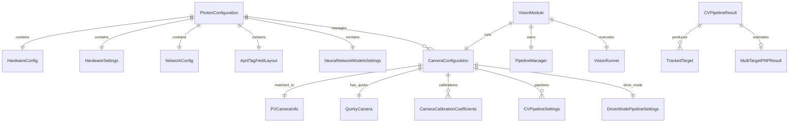
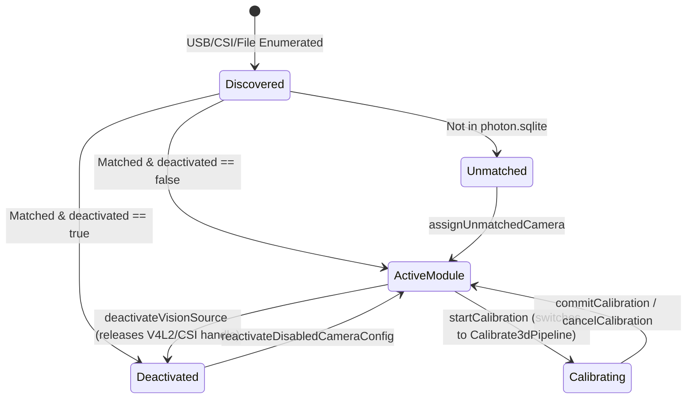

# Phase 1 Data Model: `fast-photon-core`

**Feature**: `001-fast-photon-core`  
**Date**: 2026-11-23

---

## 1. Crate & Entity Relationship Overview

---

## 2. `photon-targeting` Entities (Wire & Math Models)

### 2.1 `TargetCorner`
- **Fields**: `x: f64`, `y: f64`
- **Serialization**:
  - Photon `Packet` (`16f6ac0dedc8eaccb951f4895d9e18b6`): `float64 x; float64 y;` (16 bytes LE)
  - Protobuf: `ProtobufTargetCorner`

### 2.2 `Transform3d`, `Translation3d`, `Rotation3d`, `Quaternion`
- **Fields**:
  - `Translation3d`: `x: f64`, `y: f64`, `z: f64` (meters, NWU or EDN coordinate system)
  - `Quaternion`: `w: f64`, `x: f64`, `y: f64`, `z: f64` (unit norm invariant)
  - `Rotation3d`: `q: Quaternion` (roll/pitch/yaw accessors)
  - `Transform3d`: `translation: Translation3d`, `rotation: Rotation3d`
- **Serialization**:
  - WPILib `Struct` / Photon `Packet`: 56 bytes LE (`x, y, z, w, qx, qy, qz` as `f64`)
  - Protobuf: `wpi.proto.ProtobufTransform3d`

### 2.3 `PnpResult` & `MultiTargetPNPResult`
- **`PnpResult`**:
  - `best: Transform3d`
  - `best_reproj_err: f64`
  - `alt: Transform3d`
  - `alt_reproj_err: f64`
  - `ambiguity: f64`
  - Packet UUID: `ae4d655c0a3104dff6634d304ef3a1d3`
- **`MultiTargetPNPResult`**:
  - `estimated_pose: PnpResult`
  - `fiducial_ids_used: Vec<i16>` (VLA in `Packet`, `repeated int32` in Protobuf)
  - Packet UUID: `541096947e9f3ca2d3f425ff7b04aa7b`

### 2.4 `PhotonTrackedTarget`
- **Fields**:
  - `yaw: f64`, `pitch: f64`, `area: f64`, `skew: f64`
  - `fiducial_id: i32` (`-1` if not fiducial)
  - `obj_detect_id: i32` (`-1` if not object detection)
  - `obj_detect_conf: f32` (`-1.0` if not object detection)
  - `best_camera_to_target: Transform3d`
  - `alt_camera_to_target: Transform3d`
  - `pose_ambiguity: f64` (`-1.0` if 2D only)
  - `min_area_rect_corners: Vec<TargetCorner>` (4 corners)
  - `detected_corners: Vec<TargetCorner>` (VLA)
- **Serialization**:
  - Photon `Packet` UUID: `cc6dbb5c5c1e0fa808108019b20863f1`
  - Protobuf: `ProtobufPhotonTrackedTarget`

### 2.5 `PhotonPipelineMetadata` & `PhotonPipelineResult`
- **`PhotonPipelineMetadata`** (UUID `5231116d7f87ff560e6aa5263d0eee02`):
  - `sequence_id: i64`
  - `capture_timestamp_micros: i64`
  - `publish_timestamp_micros: i64`
  - `time_since_last_pong: i64`
- **`PhotonPipelineResult`** (UUID `fd353b11f3a818e9c5b457c7dc5a8f5c`):
  - `metadata: PhotonPipelineMetadata`
  - `targets: Vec<PhotonTrackedTarget>`
  - `multitag_result: Option<MultiTargetPNPResult>`

---

## 3. `photon-common` Entities (Configuration, SQLite & Events)

### 3.1 SQLite Schema (`photon.sqlite`, `user_version = 202704`)
- **Table `global`**:
  - `config_name TEXT PRIMARY KEY` (`hardwareConfig`, `hardwareSettings`, `networkConfig`, `fieldLayout`, `neuralNetworkProperties`)
  - `contents JSON NOT NULL`
- **Table `cameras`**:
  - `unique_name TEXT PRIMARY KEY`
  - `contents JSON NOT NULL` (serialized `CameraConfiguration`)

### 3.2 `PhotonConfiguration`
- **`HardwareConfig`**: `device_name: String`, `device_logo_path: String`, `support_url: String`, `led_pins: Vec<i32>`, `leds_can_dim: bool`, `status_led_config: StatusLedConfig`, `led_brightness_range: (i32, i32)`, `led_pwm_frequency: i32`, `cpu_temp_command: String`, etc.
- **`HardwareSettings`**: `led_brightness_percentage: i32`, `gpu_accel_enabled: bool`
- **`NetworkConfig`**: `nt_server_address: String`, `connection_type: NetworkMode` (`DHCP` | `STATIC`), `static_ip: String`, `hostname: String`, `run_nt_server: bool`, `should_manage: bool`, `should_publish_proto: bool`, `network_manager_iface: String`, `set_static_command: String`, `set_dhcp_command: String`
- **`AprilTagFieldLayout`**: `field_dimensions: FieldDimensions { length: f64, width: f64 }`, `field_tags: Vec<AprilTag { id: i32, pose: Pose3d }>`
- **`NeuralNetworkModelsSettings`**: `models: HashMap<String, Vec<ModelProperties>>`

### 3.3 `CameraConfiguration` & `PVCameraInfo`
- **`PVCameraInfo`** (tagged enum `type` in JSON):
  - `PVUsbCameraInfo { dev: i32, path: String, name: String, other_paths: Vec<String>, vendor_id: i32, product_id: i32, unique_path: String }`
  - `PVCSICameraInfo { path: String, base_name: String, unique_path: String }`
  - `PVFileCameraInfo { path: String, name: String, unique_path: String }`
- **`CameraConfiguration`**:
  - `unique_name: String`
  - `matched_camera_info: PVCameraInfo`
  - `nickname: String`
  - `deactivated: bool`
  - `camera_quirks: QuirkyCamera` (`base_name`, `usb_vid`, `usb_pid`, `display_name`, `quirks: HashMap<CameraQuirk, bool>`)
  - `fov: f64`
  - `calibrations: Vec<CameraCalibrationCoefficients>`
  - `current_pipeline_index: i32`
  - `stream_index: i32`
  - `pipeline_settings: Vec<PipelineSettingsVariant>`
  - `drive_mode_settings: DriverModePipelineSettings`

### 3.4 Polymorphic `CVPipelineSettings` (`PipelineSettingsVariant`)
Tagged by `"type"` (e.g., `"ReflectivePipelineSettings"`, `"AprilTagPipelineSettings"`, `"ArucoPipelineSettings"`, `"ColoredShapePipelineSettings"`, `"ObjectDetectionPipelineSettings"`, `"Calibration3dPipelineSettings"`, `"DriverModePipelineSettings"`, `"FocusPipelineSettings"`):
- **Base (`CVPipelineSettings`)**: `pipeline_index: i32`, `pipeline_type: PipelineType`, `image_flip_mode: ImageFlipMode`, `input_image_rotation_mode: ImageRotationMode`, `pipeline_nickname: String`, `camera_auto_exposure: bool`, `camera_exposureRaw: f64`, `camera_brightness: i32`, `camera_gain: i32`, `camera_red_gain: i32`, `camera_blue_gain: i32`, `camera_video_mode_index: i32`, `streaming_frame_divisor: FrameDivisor`, `led_mode: bool`, `input_should_show: bool`, `output_should_show: bool`.
- **Advanced (`AdvancedPipelineSettings`)**: Adds `hsv_hue: (i32, i32)`, `hsv_saturation: (i32, i32)`, `hsv_value: (i32, i32)`, `hue_inverted: bool`, `output_should_draw: bool`, `output_maximum_targets: i32`, `offset_Dual_values: DualOffsetValues`, `robot_offset_point_mode: RobotOffsetPointMode`, `contour_area: (f64, f64)`, `contour_ratio: (f64, f64)`, `contour_fullness: (f64, f64)`, `contour_speckle_percentage: i32`, `contour_sort_mode: ContourSortMode`, `contour_grouping_mode: ContourGroupingMode`, `contour_intersection: ContourIntersectionDirection`, `solve_pnp_enabled: bool`, `target_model: TargetModel`, `corner_detection_strategy: CornerDetectionStrategy`, etc.
- **Pipeline-Specific Fields**:
  - `AprilTagPipelineSettings`: `tag_family: AprilTagFamily`, `decimate: i32`, `blur: f64`, `threads: i32`, `debug: bool`, `refine_edges: bool`, `num_iterations: i32`, `hamming_dist: i32`, `decision_margin: i32`, `do_multi_target: bool`, `do_single_target_always: bool`.
  - `ArucoPipelineSettings`: `tag_family: AprilTagFamily`, `thresh_win_sizes: (i32, i32)`, `thresh_step_size: i32`, `thresh_constant: f64`, `use_corner_refinement: bool`, `do_multi_target: bool`, `do_single_target_always: bool`.
  - `ObjectDetectionPipelineSettings`: `confidence: f64`, `model: String`, `nms: f64`, `max_detections: i32`.
  - `Calibration3dPipelineSettings`: `board_height: i32`, `board_width: i32`, `board_type: UICalibrationDataBoardType`, `grid_size: f64`, `marker_size: f64`, `tag_family: UICalibrationDataTagFamily`, `use_mr_cal: bool`, `lens_model: CameraLensModel`.

### 3.5 `DataChangeEvent` & WebSocket UI DTOs
- **`DataChangeSource`**: `DCS_WEBSOCKET`, `DCS_NETWORKTABLES`, `DCS_VISIONMODULE`, `DCS_OTHER`
- **`DataChangeDestination`**: `DCD_GENSETTINGS`, `DCD_ACTIVEMODULE`, `DCD_ACTIVEPIPELINESETTINGS`, `DCD_UI`, `DCD_WEBSERVER`, `DCD_OTHER`
- **`UIPhotonConfiguration`**: Full initial state payload sent over `/websocket_data` when a client connects (`programSettings`, `cameraSettings: Vec<UICameraConfiguration>`, `networkSettings`, `lightingConfig`, `general`).

---

## 4. `photon-vision` Entities (Frames, Calibration, Targets & State Transitions)

### 4.1 `CVMat`, `Frame` & `FrameStaticProperties`
- **`CVMat`**: RAII wrapper around `opencv::core::Mat` with optional buffer-pool return handle on `Drop`.
- **`FrameStaticProperties`**: `image_width: i32`, `image_height: i32`, `fov: f64`, `image_area: f64`, `center_point: (f64, f64)`, `horizontal_focal_length: f64`, `vertical_focal_length: f64`, `camera_calibration: Option<CameraCalibrationCoefficients>`.
- **`Frame`**: `sequence_id: i64`, `color_image: CVMat`, `processed_image: CVMat`, `threshold_type: FrameThresholdType`, `timestamp_nanos: i64`, `static_properties: Arc<FrameStaticProperties>`.

### 4.2 `CameraCalibrationCoefficients` & `BoardObservation`
- **`CameraCalibrationCoefficients`**:
  - `resolution: (i32, i32)`
  - `camera_intrinsics: JsonMatOfDouble` (3×3 `[fx, 0, cx, 0, fy, cy, 0, 0, 1]`)
  - `dist_coeffs: JsonMatOfDouble` (5, 8, or mrcal coefficients)
  - `cal_object_warp: Vec<f64>`
  - `observations: Vec<BoardObservation>`
  - `cal_object_size: (i32, i32)`
  - `lens_model: CameraLensModel` (`LENSMODEL_OPENCV`, `LENSMODEL_SPLINED_STEREOGRAPHIC`)
  - `mean_errors: Vec<f64>`

### 4.3 `VisionModule` & `VisionSourceManager` State Transitions

