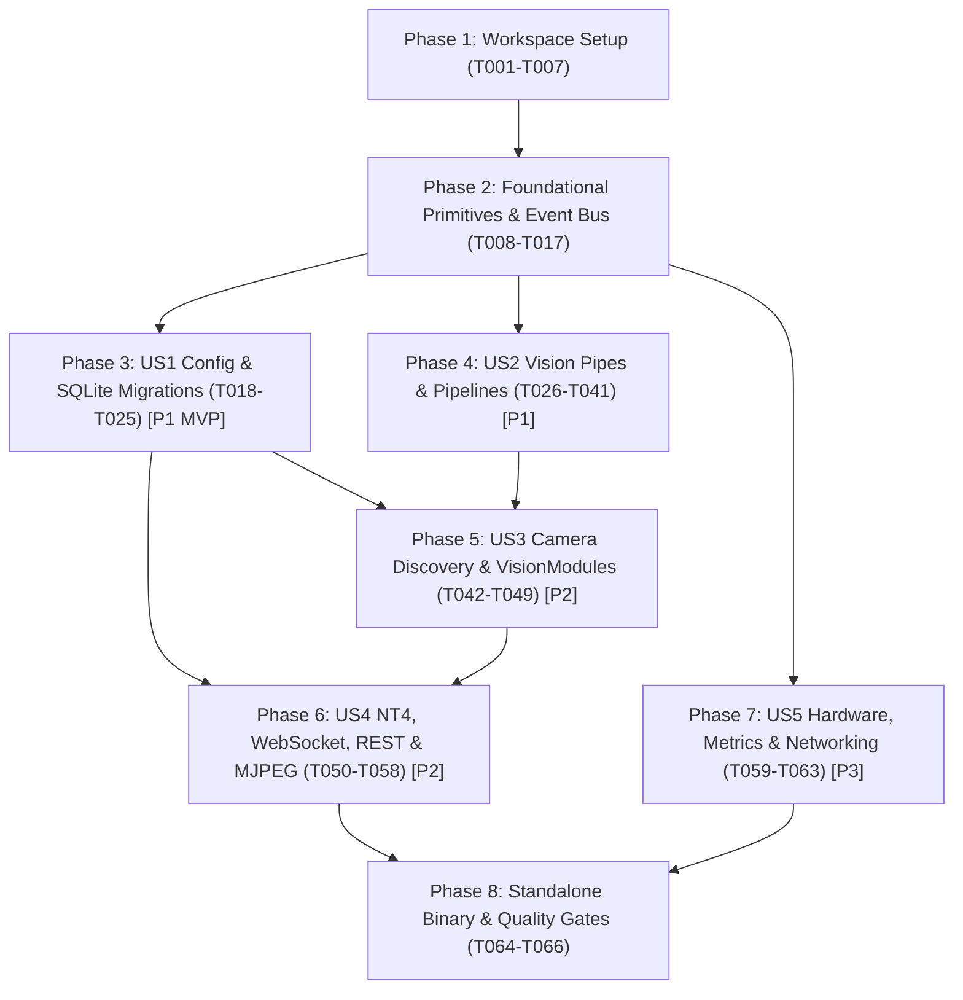

# Tasks: Migrate `photon-core` to Rust (`fast-photon-core`)

**Input**: Design documents from `/specs/001-fast-photon-core/`
**Prerequisites**: [`plan.md`](file:///home/rose/Documents/workspace_local/photonvision/specs/001-fast-photon-core/plan.md) (required), [`spec.md`](file:///home/rose/Documents/workspace_local/photonvision/specs/001-fast-photon-core/spec.md) (required for user stories), [`research.md`](file:///home/rose/Documents/workspace_local/photonvision/specs/001-fast-photon-core/research.md), [`data-model.md`](file:///home/rose/Documents/workspace_local/photonvision/specs/001-fast-photon-core/data-model.md), [`contracts/`](file:///home/rose/Documents/workspace_local/photonvision/specs/001-fast-photon-core/contracts/)

**Tests**: Automated `cargo test` parity suites are MANDATORY per Constitution Principle V (`Test-Driven Parity & Benchmarking Discipline`) and Success Criteria `SC-001`–`SC-005`.

**Organization**: Tasks are grouped by user story (`US1`–`US5`) to enable independent implementation, verification, and incremental delivery of each story.

## Format: `[ID] [P?] [Story] Description`

- **[P]**: Can run in parallel (different files/crates, no dependencies on incomplete tasks)
- **[Story]**: Which user story this task belongs to (`[US1]`, `[US2]`, `[US3]`, `[US4]`, `[US5]`)
- Exact file paths under `fast-photon-core/` are included in every task description

## Path Conventions

- **Workspace Root**: `fast-photon-core/Cargo.toml`, `fast-photon-core/src/`
- **Domain Sub-Crates**: `fast-photon-core/crates/{photon-targeting,photon-common,photon-hal,photon-vision,photon-web}/`
- **Workspace Integration Tests**: `fast-photon-core/tests/`

---

## Phase 1: Setup (Shared Workspace Infrastructure)

**Purpose**: Initialize the `fast-photon-core/` Cargo workspace, sub-crate manifests, feature flags, and linting/formatting configurations.

- [X] T001 Create Cargo workspace manifest with shared dependency versions and feature flags in `fast-photon-core/Cargo.toml`
- [X] T002 [P] Initialize `photon-targeting` crate manifest and protobuf build script in `fast-photon-core/crates/photon-targeting/Cargo.toml` and `fast-photon-core/crates/photon-targeting/build.rs`
- [X] T003 [P] Initialize `photon-common` crate manifest in `fast-photon-core/crates/photon-common/Cargo.toml`
- [X] T004 [P] Initialize `photon-hal` crate manifest with `gpio` feature flag in `fast-photon-core/crates/photon-hal/Cargo.toml`
- [X] T005 [P] Initialize `photon-vision` crate manifest with `rknn`, `tflite`, `libcamera`, and `mrcal` feature flags in `fast-photon-core/crates/photon-vision/Cargo.toml`
- [X] T006 [P] Initialize `photon-web` crate manifest in `fast-photon-core/crates/photon-web/Cargo.toml`
- [X] T007 Configure `rustfmt.toml`, workspace Clippy lints (`deny(unsafe_code)` outside FFI modules, `warn(clippy::unwrap_used)`), and crate stub entrypoints in `fast-photon-core/rustfmt.toml` and `fast-photon-core/src/lib.rs`

---

## Phase 2: Foundational (Core Wire Primitives, Geometry, Event Bus & Utilities)

**Purpose**: Core foundational primitives (`Packet`, 3D geometry, `PhotonPipelineResult` wire types, logging, utilities, and `DataChangeService` pub/sub event bus) that MUST be complete before user stories can be implemented.

**⚠️ CRITICAL**: No user story work can begin until this phase is complete.

- [X] T008 [P] Implement little-endian `Packet` byte buffer and `PacketSerde` trait (including VLA lists and optionals) in `fast-photon-core/crates/photon-targeting/src/packet.rs`
- [X] T009 [P] Implement 3D geometry primitives (`Translation3d`, `Quaternion`, `Rotation3d`, `Transform3d`, `Pose3d`) and 56-byte WPILib `Struct` binary serialization in `fast-photon-core/crates/photon-targeting/src/geometry.rs`
- [X] T010 Implement `TargetCorner`, `PnpResult`, `MultiTargetPNPResult`, and `PhotonTrackedTarget` with exact MD5 interface UUIDs and `PacketSerde` implementations in `fast-photon-core/crates/photon-targeting/src/targets.rs`
- [X] T011 Implement `PhotonPipelineMetadata` and `PhotonPipelineResult` with `PacketSerde` (`fd353b11f3a818e9c5b457c7dc5a8f5c`) in `fast-photon-core/crates/photon-targeting/src/result.rs`
- [X] T012 [P] Compile `photon.proto` and `geometry3d.proto` via `prost` and implement conversions to/from `PhotonPipelineResult` and `DeviceMetrics` in `fast-photon-core/crates/photon-targeting/src/proto.rs`
- [X] T013 [P] Implement `TargetModel`, `CameraTargetRelation`, `RotTrlTransform3d`, and `VisionEstimation` 3D math helpers in `fast-photon-core/crates/photon-targeting/src/estimation.rs`
- [X] T014 [P] Implement structured `Logger`, `LogGroup`, `LogLevel`, and `KernelLogLogger` in `fast-photon-core/crates/photon-common/src/logging.rs`
- [X] T015 [P] Implement `TimedTaskManager`, `MathUtils` (AprilTag/OpenCV/WPILib coordinate conversions), `ColorHelper`, and `NumberCouple`/`DoubleCouple`/`IntegerCouple` in `fast-photon-core/crates/photon-common/src/util.rs`
- [X] T016 Implement `DataChangeService`, `DataChangeEvent` (`IncomingWebSocketEvent`, `OutgoingUIEvent`), `DataChangeSource`, `DataChangeDestination`, and `CVPipelineResultConsumer` in `fast-photon-core/crates/photon-common/src/dataflow/mod.rs`
- [X] T017 Export foundational APIs in `fast-photon-core/crates/photon-targeting/src/lib.rs` and `fast-photon-core/crates/photon-common/src/lib.rs` and verify byte-level `Packet`/Protobuf round-trips in `fast-photon-core/tests/packet_and_proto_parity.rs`

**Checkpoint**: Foundation ready — user story implementation can now proceed.

---

## Phase 3: User Story 1 - Drop-In Configuration & Data Compatibility (Priority: P1) 🎯 MVP

**Goal**: Load, migrate, query, modify, export, and import `photon.sqlite` databases and configuration `.zip` archives with 100% schema and JSON parity with Java `photon-core`.

**Independent Test**: Run `cargo test --test sqlite_migration_parity` against existing `photon.sqlite` databases and config archives in `../test-resources/` to verify schema migration (`2` → `202701`..`202704`) and lossless JSON round-tripping.

### Tests for User Story 1 ⚠️

- [X] T018 [P] [US1] Create SQLite schema migration and JSON round-trip parity test suite against `../test-resources/` in `fast-photon-core/tests/sqlite_migration_parity.rs`

### Implementation for User Story 1

- [X] T019 [P] [US1] Implement `HardwareConfig`, `HardwareSettings`, and `StatusLedConfig` JSON models in `fast-photon-core/crates/photon-common/src/configuration/hardware.rs`
- [X] T020 [P] [US1] Implement `NetworkConfig` and `NetworkMode` JSON models in `fast-photon-core/crates/photon-common/src/configuration/network.rs`
- [X] T021 [P] [US1] Implement `AprilTagFieldLayout` (`field-dimensions`, `field-tags`), `NeuralNetworkModelsSettings`, and `NeuralNetworkModelManager` in `fast-photon-core/crates/photon-common/src/configuration/neural_network.rs`
- [X] T022 [US1] Implement `PVCameraInfo` (`PVUsbCameraInfo`, `PVCSICameraInfo`, `PVFileCameraInfo`), `QuirkyCamera`, `CameraQuirk`, `CameraCalibrationCoefficients`, `BoardObservation`, and polymorphic `PipelineSettingsVariant` (`CVPipelineSettings` + all 8 pipeline settings types) in `fast-photon-core/crates/photon-common/src/configuration/camera.rs`
- [X] T023 [US1] Implement `MigrationManager` and `DbMigration` steps (`2`, `202701` camera config & legacy tuple pipelines, `202702` table rename, `202703` `statusRGBPins` → `statusLEDConfig`, `202704` `apriltagFieldLayout` → `fieldLayout`) in `fast-photon-core/crates/photon-common/src/configuration/migrations.rs`
- [X] T024 [US1] Implement `ConfigProvider` SQLite read/write operations (`global` and `cameras` tables) and `.zip` archive import/export (`saveUploadedSettingsZip`) in `fast-photon-core/crates/photon-common/src/configuration/sql.rs`
- [X] T025 [US1] Implement `PhotonConfiguration`, `PathManager`, and `ProgramDirectoryUtilities` in `fast-photon-core/crates/photon-common/src/configuration/mod.rs`

**Checkpoint**: User Story 1 (`photon.sqlite` persistence, migrations, and config archives) is complete and independently verifiable.

---

## Phase 4: User Story 2 - Vision Pipeline & Target Localization Parity (Priority: P1)

**Goal**: Execute all 37 `CVPipe` stages and all 9 `CVPipeline` types on input frames with RAII memory safety (`CVMat`), returning 2D and 3D `TrackedTarget` and `CVPipelineResult` outputs matching the Java reference within defined numerical tolerances (`SC-001`, `SC-003`).

**Independent Test**: Run `cargo test --test pipeline_numerical_parity` using `FileFrameProvider` on `../test-resources/` images across all 9 pipelines and verify 2D/3D target assertions and zero memory leaks over multi-frame runs.

### Tests for User Story 2 ⚠️

- [X] T026 [P] [US2] Create headless pipeline numerical parity and memory stability test suite against `../test-resources/` in `fast-photon-core/tests/pipeline_numerical_parity.rs`

### Implementation for User Story 2

- [X] T027 [P] [US2] Implement RAII `CVMat` (with bounded pool support), `Contour`, `CVShape`, `DualOffsetValues`, `ImageRotationMode`, `ImageFlipMode`, `ContourGroupingMode`, `ContourSortMode`, and `ContourIntersectionDirection` in `fast-photon-core/crates/photon-vision/src/opencv_ext.rs`
- [X] T028 [P] [US2] Implement `Frame`, `FrameStaticProperties`, `FrameDivisor`, `FrameThresholdType`, `StaticFrames`, and `FileFrameProvider` in `fast-photon-core/crates/photon-vision/src/frame/mod.rs` and `fast-photon-core/crates/photon-vision/src/frame/provider.rs`
- [X] T029 [P] [US2] Implement `PotentialTarget`, `TrackedTarget`, `TargetCalculations`, `RobotOffsetPointMode`, `RobotOffsetPointOperation`, `TargetOffsetPointEdge`, and `TargetOrientation` in `fast-photon-core/crates/photon-vision/src/target.rs`
- [X] T030 [P] [US2] Implement `AprilTagFamily`, `ArucoDetectionResult`, and `PhotonArucoDetector` in `fast-photon-core/crates/photon-vision/src/apriltag_aruco.rs`
- [X] T031 [P] [US2] Implement `CameraLensModel`, `JsonMatOfDouble`, `UICameraCalibrationCoefficients`, and calibration math helpers in `fast-photon-core/crates/photon-vision/src/calibration.rs`
- [X] T032 [P] [US2] Implement `Model`, `ObjectDetector`, `Letterbox`, `NullModel`, and feature-gated `RknnModel`/`RknnObjectDetector` and `TFLiteModel`/`TFLiteObjectDetector` in `fast-photon-core/crates/photon-vision/src/objects.rs`
- [X] T033 [US2] Implement `CVPipe<I, O, P>` and `MutatingPipe` traits with nanosecond profiling in `fast-photon-core/crates/photon-vision/src/pipe/mod.rs`
- [X] T034 [P] [US2] Implement image pre-processing pipes (`RotateImagePipe`, `ResizeImagePipe`, `GrayscalePipe`, `HSVPipe`, `OutputMatPipe`, `CalculateFPSPipe`, `FocusPipe`) in `fast-photon-core/crates/photon-vision/src/pipe/impls/preprocess.rs`
- [X] T035 [P] [US2] Implement contour and shape pipes (`FindContoursPipe`, `SpeckleRejectPipe`, `FilterContoursPipe`, `GroupContoursPipe`, `SortContoursPipe`, `FindPolygonPipe`, `FindCirclesPipe`, `FilterShapesPipe`, `CornerDetectionPipe`, `Collect2dTargetsPipe`) in `fast-photon-core/crates/photon-vision/src/pipe/impls/contours.rs`
- [X] T036 [P] [US2] Implement fiducial, PnP, calibration, and object detection pipes (`AprilTagDetectionPipe`, `AprilTagPoseEstimatorPipe`, `ArucoDetectionPipe`, `ArucoPoseEstimatorPipe`, `SolvePNPPipe`, `MultiTargetPNPPipe`, `ObjectDetectionPipe`, `FilterObjectDetectionsPipe`, `FindBoardCornersPipe`, `Calibrate3dPipe`) in `fast-photon-core/crates/photon-vision/src/pipe/impls/localization.rs`
- [X] T037 [P] [US2] Implement 2D/3D overlay drawing pipes (`Draw2dCrosshairPipe`, `Draw2dTargetsPipe`, `Draw3dTargetsPipe`, `Draw2dAprilTagsPipe`, `Draw3dAprilTagsPipe`, `Draw2dArucoPipe`, `Draw3dArucoPipe`, `DrawCalibrationPipe`) in `fast-photon-core/crates/photon-vision/src/pipe/impls/drawing.rs`
- [X] T038 [US2] Implement `CVPipeline` trait, `PipelineType`, `PipelineProfiler`, and result containers (`CVPipelineResult`, `CalibrationPipelineResult`, `DriverModePipelineResult`, `FocusPipelineResult`) in `fast-photon-core/crates/photon-vision/src/pipeline/mod.rs`
- [X] T039 [P] [US2] Implement `ReflectivePipeline`, `ColoredShapePipeline`, `DriverModePipeline`, `FocusPipeline`, and `OutputStreamPipeline` in `fast-photon-core/crates/photon-vision/src/pipeline/reflective.rs`, `colored_shape.rs`, `driver_mode.rs`, `focus.rs`, and `output_stream.rs`
- [X] T040 [P] [US2] Implement `AprilTagPipeline` and `ArucoPipeline` (with clean pipe-based single- and multi-tag estimation) in `fast-photon-core/crates/photon-vision/src/pipeline/apriltag.rs` and `aruco.rs`
- [X] T041 [P] [US2] Implement `ObjectDetectionPipeline` and `Calibrate3dPipeline` in `fast-photon-core/crates/photon-vision/src/pipeline/object_detection.rs` and `calibrate3d.rs`

**Checkpoint**: User Story 2 (all 37 vision pipes and 9 vision pipelines) is complete and verified against `../test-resources/`.

---

## Phase 5: User Story 3 - Camera Discovery, Quirks & Multi-Camera Lifecycle (Priority: P2)

**Goal**: Discover USB, CSI, and file cameras, apply sensor-specific `CameraQuirk` profiles, and orchestrate concurrent `VisionModule` worker threads (`VisionRunner` + `PipelineManager`) with dynamic activation/deactivation.

**Independent Test**: Run `cargo test -p photon-vision` with mock/file and USB camera descriptors to verify quirk detection, device blacklisting (`bcm2835-isp`), `VisionModule` thread isolation, and camera activation/deactivation lifecycle transitions.

### Implementation for User Story 3

- [X] T042 [P] [US3] Implement `CameraType`, `QuirkyCamera` matcher, `FileVisionSource`, and `TestSource` in `fast-photon-core/crates/photon-vision/src/camera/mod.rs`
- [X] T043 [P] [US3] Implement `USBCameraSource`, Linux `v4l` `mmap` capture & `ioctl` controls (`USBFrameProvider` + OpenCV fallback), and all 11 sensor-specific settables (`GenericUSBCameraSettables`, `ArduOV9281`, `ArduOV2311`, `ArduOV9782`, `InnoOV9281`, `ThriftyOV9281`, `LifeCam3k`, `PsEye`, `See3Cam24CUG`) in `fast-photon-core/crates/photon-vision/src/camera/usb.rs`
- [X] T044 [P] [US3] Implement feature-gated CSI `LibcameraGpuSource`, `LibcameraGpuSettables`, and `LibcameraGpuFrameProvider` in `fast-photon-core/crates/photon-vision/src/camera/csi.rs`
- [X] T045 [P] [US3] Implement `FileSaveFrameConsumer` and `MJPGFrameConsumer` channel publishers in `fast-photon-core/crates/photon-vision/src/frame/consumer.rs`
- [X] T046 [US3] Implement `VisionSource`, `VisionSourceSettables`, and thread-safe `PipelineManager` in `fast-photon-core/crates/photon-vision/src/processes/mod.rs` and `fast-photon-core/crates/photon-vision/src/processes/pipeline_manager.rs`
- [X] T047 [US3] Implement asynchronous `VisionRunner` frame loop with hot-unplug recovery and FPS limiting in `fast-photon-core/crates/photon-vision/src/processes/vision_runner.rs`
- [X] T048 [US3] Implement `VisionModule` (with decoupled `StreamRunnable` thread and calibration session state) and `VisionModuleChangeSubscriber` in `fast-photon-core/crates/photon-vision/src/processes/vision_module.rs`
- [X] T049 [US3] Implement `VisionSourceManager` and `VisionModuleManager` (camera discovery, blacklisting, config matching, assignment, deactivation, reactivation) in `fast-photon-core/crates/photon-vision/src/processes/vision_source_manager.rs`

**Checkpoint**: User Story 3 (camera discovery, quirk settables, and multi-camera `VisionModule` orchestration) is complete and independently testable.

---

## Phase 6: User Story 4 - Real-Time NetworkTables (NT4), WebSocket & MJPEG Dataflow (Priority: P2)

**Goal**: Publish and subscribe to all NetworkTables v4 topics (`NTTopicSet`), synchronize clocks via UDP TimeSync (`5810`), serve binary MessagePack WebSocket events on `/websocket_data`, serve all 36 `/api/*` REST routes on port `5800`, and stream MJPEG video on ports `1181+`.

**Independent Test**: Run `cargo test --test websocket_and_rest_contract` to verify NT4 topic publication/subscription, UDP TimeSync, `/websocket_data` MessagePack commands, REST settings/calibration/model endpoints, and MJPEG multipart HTTP streams.

### Tests for User Story 4 ⚠️

- [X] T050 [P] [US4] Create WebSocket MessagePack, REST API, MJPEG stream, and NT4 topic contract test suite in `fast-photon-core/tests/websocket_and_rest_contract.rs`

### Implementation for User Story 4

- [X] T051 [P] [US4] Implement UDP `TimeSyncClient` and `TimeSyncServer` (port `5810`) and `TimeSyncManager` publishing `/photonvision/.timesync/<hostname>/*` in `fast-photon-core/crates/photon-common/src/dataflow/networktables/timesync.rs`
- [X] T052 [P] [US4] Implement `NTDriverStation` alliance/FMS state listener in `fast-photon-core/crates/photon-common/src/dataflow/networktables/driverstation.rs`
- [X] T053 [US4] Implement `NetworkTablesManager`, `NTTopicSet`, `NTDataPublisher`, and `NTDataChangeListener` (publishing `rawBytes`, `result_proto`, `targetPose`, scalars, and handling `pipelineIndexRequest`, `driverModeRequest`, `fpsLimitRequest`, `enabledRequest`) in `fast-photon-core/crates/photon-common/src/dataflow/networktables/mod.rs`
- [X] T054 [P] [US4] Implement `UIDataPublisher` and WebSocket UI DTOs (`UIPhotonConfiguration`, `UICameraConfiguration`, `UIGeneralSettings`, `UILightingConfig`, `UINetConfig`, `UIProgramSettings`) in `fast-photon-core/crates/photon-common/src/dataflow/websocket.rs`
- [X] T055 [P] [US4] Implement per-camera async MJPEG HTTP streaming server (`multipart/x-mixed-replace; boundary=frame` on ports `1181+`) in `fast-photon-core/crates/photon-web/src/mjpeg.rs`
- [X] T056 [US4] Implement `/websocket_data` binary MessagePack (`rmp-serde`) handler supporting all 16 `DataSocketMessageType` commands and outbound UI broadcasts in `fast-photon-core/crates/photon-web/src/websocket.rs`
- [X] T057 [US4] Implement all 36 `/api/*` HTTP REST handlers (`/api/status`, `/api/settings/*`, `/api/utils/*`, `/api/calibration/*`, `/api/objectdetection/*`, `/api/test/*`) in `fast-photon-core/crates/photon-web/src/handlers.rs`
- [X] T058 [US4] Assemble the `axum` HTTP/WebSocket router, CORS layer, and static web UI serving on port `5800` in `fast-photon-core/crates/photon-web/src/server.rs` and `fast-photon-core/crates/photon-web/src/lib.rs`

**Checkpoint**: User Story 4 (NT4, TimeSync, MessagePack WebSocket, REST API, and MJPEG streaming) is complete and independently verifiable.

---

## Phase 7: User Story 5 - Coprocessor Hardware, LEDs, Metrics & OS Networking (Priority: P3)

**Goal**: Provide platform detection, GPIO vision/status LED control, periodic hardware metrics (`DeviceMetrics` / `ProtobufDeviceMetrics`), and Linux `nmcli` network configuration with safe desktop fallbacks.

**Independent Test**: Run `cargo test -p photon-hal` to verify platform detection, LED state transitions (`StatusLEDConsumer`), `SystemMonitor` metrics collection, and `nmcli` command construction with bounded timeouts.

### Implementation for User Story 5

- [X] T059 [P] [US5] Implement `Platform`, `OSType`, `PiVersion`, `PlatformUtils` (with command execution timeout), and `OsImageData` in `fast-photon-core/crates/photon-hal/src/platform.rs`
- [X] T060 [P] [US5] Implement GPIO/PWM hardware traits (`CustomAdapter`, `CustomDeviceFactory`, digital input/output, PWM output) and simulated desktop fallback in `fast-photon-core/crates/photon-hal/src/gpio.rs`
- [X] T061 [US5] Implement `HardwareManager`, `VisionLED`, `StatusLED` (`RGBStatusLED`, `GreenYellowStatusLED`), `PhotonStatus`, and `StatusLEDConsumer` in `fast-photon-core/crates/photon-hal/src/hardware_manager.rs`
- [X] T062 [P] [US5] Implement `DeviceMetrics` and platform-specific `SystemMonitor` implementations (`SystemMonitorRaspberryPi`, `SystemMonitorRK3588`, `SystemMonitorQCS6490`, `SystemMonitorWindows`, and generic Linux) in `fast-photon-core/crates/photon-hal/src/metrics.rs`
- [X] T063 [P] [US5] Implement `NetworkManager`, `NetworkingCommands` (`nmcli` static/DHCP/hostname configuration), and `NetworkUtils` in `fast-photon-core/crates/photon-hal/src/networking.rs` and export public HAL APIs in `fast-photon-core/crates/photon-hal/src/lib.rs`

**Checkpoint**: User Story 5 (hardware LEDs, system metrics, and OS networking) is complete.

---

## Phase 8: Polish, Standalone Binary Integration & Cross-Cutting Quality Gates

**Purpose**: Wire all 5 sub-crates together into the top-level `fast-photon-core` facade library and standalone CLI binary, add performance benchmarks, and validate all Constitution and Quickstart gates.

- [X] T064 Implement top-level library re-exports and standalone runtime binary entrypoint (CLI flags `--config-dir`, `--port`, `--test-mode`, signal handling, and graceful shutdown) in `fast-photon-core/src/lib.rs` and `fast-photon-core/src/main.rs`
- [X] T065 [P] Add hot-path pipeline throughput and latency jitter benchmark suite in `fast-photon-core/benches/pipeline_benchmarks.rs`
- [X] T066 Run full workspace formatting (`cargo fmt --all -- --check`), strict Clippy lints (`cargo clippy --workspace --all-targets -- -D warnings`), and full parity test suite (`cargo test --workspace`) per `specs/001-fast-photon-core/quickstart.md`

---

## Dependencies & Execution Order

### Phase Dependencies



### User Story Dependencies

- **User Story 1 (P1 - Configuration & SQLite)**: Depends only on Phase 2 (`Foundational`). Can start immediately after T017.
- **User Story 2 (P1 - Vision Pipelines & Target Localization)**: Depends on Phase 2 (`Foundational`) and `CameraCalibrationCoefficients`/`CVPipelineSettings` from `US1` (T022). Can run largely in parallel with `US1`.
- **User Story 3 (P2 - Camera Discovery, Quirks & Multi-Camera Lifecycle)**: Depends on `US1` (`CameraConfiguration`, `QuirkyCamera`) and `US2` (`FrameProvider`, `CVPipeline`).
- **User Story 4 (P2 - NetworkTables, WebSocket, REST & MJPEG)**: Depends on `US1` (`ConfigProvider`), `US2` (`CVPipelineResult`), and `US3` (`VisionSourceManager`, `VisionModule`).
- **User Story 5 (P3 - Coprocessor Hardware, LEDs, Metrics & OS Networking)**: Depends only on Phase 2 (`Foundational`) and `US1` (`HardwareConfig`, `NetworkConfig`). Can be developed in parallel with `US2`–`US4`.

### Parallel Opportunities

- **Phase 1**: T002, T003, T004, T005, T006 can all run in parallel after T001.
- **Phase 2**: T008, T009, T012, T013, T014, T015 can all run in parallel.
- **Phase 3 (US1)**: T018, T019, T020, T021 can run in parallel.
- **Phase 4 (US2)**: T026, T027, T028, T029, T030, T031, T032 can run in parallel; pipe groups T034, T035, T036, T037 can run in parallel; pipelines T039, T040, T041 can run in parallel.
- **Phase 5 (US3)**: T042, T043, T044, T045 can run in parallel.
- **Phase 6 (US4)**: T050, T051, T052, T054, T055 can run in parallel.
- **Phase 7 (US5)**: T059, T060, T062, T063 can run in parallel.

---

## Parallel Example: User Story 2 (Vision Pipes & Pipelines)

```bash
# Parallel Batch 1: Core Vision Models & Wrappers
Task T027: "Implement RAII CVMat, Contour, CVShape in fast-photon-core/crates/photon-vision/src/opencv_ext.rs"
Task T028: "Implement Frame, FrameStaticProperties, FileFrameProvider in fast-photon-core/crates/photon-vision/src/frame/"
Task T029: "Implement PotentialTarget, TrackedTarget, TargetCalculations in fast-photon-core/crates/photon-vision/src/target.rs"
Task T030: "Implement AprilTagFamily, PhotonArucoDetector in fast-photon-core/crates/photon-vision/src/apriltag_aruco.rs"

# Parallel Batch 2: All 37 Vision Pipes by Category
Task T034: "Implement preprocessing pipes in fast-photon-core/crates/photon-vision/src/pipe/impls/preprocess.rs"
Task T035: "Implement contour and shape pipes in fast-photon-core/crates/photon-vision/src/pipe/impls/contours.rs"
Task T036: "Implement fiducial, PnP, calibration, and object detection pipes in fast-photon-core/crates/photon-vision/src/pipe/impls/localization.rs"
Task T037: "Implement 2D/3D overlay drawing pipes in fast-photon-core/crates/photon-vision/src/pipe/impls/drawing.rs"
```

---

## Implementation Strategy

### MVP First (User Stories 1 & 2)

1. Complete **Phase 1: Setup** (T001–T007)
2. Complete **Phase 2: Foundational** (T008–T017) — verifies binary `Packet`, `Struct`, and `Protobuf` wire parity.
3. Complete **Phase 3: User Story 1** (T018–T025) — verifies 100% `photon.sqlite` migration and JSON configuration compatibility.
4. Complete **Phase 4: User Story 2** (T026–T041) — verifies headless execution of all 37 pipes and 9 vision pipelines against `../test-resources/` within numerical tolerances.
5. **STOP and VALIDATE**: Confirm `cargo test --test sqlite_migration_parity --test packet_and_proto_parity --test pipeline_numerical_parity` passes cleanly.

### Incremental Full Engine Delivery

6. Complete **Phase 5: User Story 3** (T042–T049) — adds live USB V4L2/CSI camera capture, quirk settables, and multi-camera `VisionModule` worker threads.
7. Complete **Phase 6: User Story 4** (T050–T058) — connects live NetworkTables v4, UDP TimeSync, MessagePack `/websocket_data`, REST `/api/*`, and MJPEG stream ports `1181+`.
8. Complete **Phase 7: User Story 5** (T059–T063) & **Phase 8: Polish** (T064–T066) — completes coprocessor hardware LEDs, metrics, `nmcli` networking, standalone binary entrypoint, and final quality gates.
