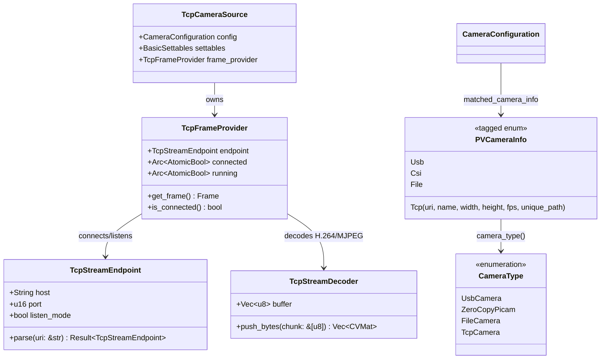

# Phase 1 Data Model: Local Network TCP Camera Stream Source (`rpicam-vid`)

**Feature**: `002-tcp-camera-source`  
**Date**: 2026-11-23

---

## 1. Entity & Component Relationships



---

## 2. Configuration Entities (`crates/photon-common`)

### 2.1 `CameraType::TcpCamera`
- Added to `photon_common::configuration::CameraType`:
  - `UsbCamera`
  - `ZeroCopyPicam`
  - `FileCamera`
  - `TcpCamera` (New)

### 2.2 `PVCameraInfo::Tcp` (`PVTcpCameraInfo`)
- **JSON Tag**: `"type": "PVCameraInfo.PVTcpCameraInfo"` (with `alias = "PVTcpCameraInfo"`)
- **Fields**:
  - `uri: String` — TCP stream URI, e.g. `"tcp://192.168.1.50:8888"` or `"tcp://0.0.0.0:8888?listen=true"`
  - `name: String` — Human-readable camera name (default `"rpicam-tcp"`)
  - `width: i32` — Configured frame width in pixels (default `1280`)
  - `height: i32` — Configured frame height in pixels (default `720`)
  - `fps: i32` — Target frame rate (default `30`)
  - `unique_path: String` — Canonical unique identifier (defaults to `uri` if empty)
- **Validation Rules**:
  - `uri` MUST start with `tcp://` (or be a valid `host:port` authority) with port in `1..=65535`.
  - `width` and `height` default to `1280` and `720` when omitted or `<= 0`.
  - `fps` defaults to `30` when omitted or `<= 0`.

---

## 3. Vision & Streaming Entities (`crates/photon-vision`)

### 3.1 `TcpStreamEndpoint`
- **Fields**:
  - `raw_uri: String`
  - `host: String`
  - `port: u16`
  - `listen: bool` (`true` when query string contains `listen=true` or `listen=1`, `false` by default for `rpicam-vid --listen`)
- **Behavior**:
  - `TcpStreamEndpoint::parse(uri: &str) -> Result<Self, String>` parses `"tcp://192.168.1.50:8888"`, `"127.0.0.1:8888"`, or `"tcp://0.0.0.0:8888?listen=true"`.

### 3.2 `TcpStreamCodec` & `TcpStreamDecoder`
- **`TcpStreamCodec`**:
  - `Auto` (detects H.264 Annex-B `0x00 0x00 0x00 0x01` / `0x00 0x00 0x01` vs. JPEG SOI `0xFF 0xD8`)
  - `H264AnnexB`
  - `Mjpeg`
- **`TcpStreamDecoder`**:
  - Maintains a bounded byte buffer (`MAX_STREAM_BUFFER_BYTES = 8 * 1024 * 1024`) and an `openh264::decoder::Decoder`.
  - `push_bytes(&mut self, bytes: &[u8]) -> Vec<CVMat>`:
    - Appends `bytes` (enforcing the 8 MiB cap).
    - Extracts complete MJPEG frames (`0xFF 0xD8`..`0xFF 0xD9`) or H.264 Annex-B access units (synced from the first `--inline` SPS `0x67` NAL unit) and decodes them into RGB `CVMat` instances.

### 3.3 `TcpFrameProvider`
- **Fields**:
  - `name: String`
  - `endpoint: TcpStreamEndpoint`
  - `fov: f64`
  - `calibration: Option<CameraCalibrationCoefficients>`
  - `static_props: Arc<FrameStaticProperties>` (initialized to `(width, height)`, e.g. `1280×720`, and dynamically updated if decoded frame resolution changes)
  - `latest_mat: Arc<RwLock<Option<CVMat>>>`
  - `connected: Arc<AtomicBool>`
  - `running: Arc<AtomicBool>`
  - `sequence_id: i64`
  - `worker_handle: Option<JoinHandle<()>>`
- **Lifecycle & State Transitions**:
  ```mermaid
  stateDiagram-v2
      [*] --> Connecting : TcpFrameProvider::new()
      Connecting --> Streaming : TCP Connected & First Frame Decoded (connected = true)
      Connecting --> BackoffRetry : Connect Timeout / Refused (connected = false)
      Streaming --> BackoffRetry : Socket EOF / Read Error / Deactivated (connected = false)
      BackoffRetry --> Connecting : After 100ms Retry Delay
      Streaming --> Stopped : Drop / stop() (running = false)
      BackoffRetry --> Stopped : Drop / stop() (running = false)
  ```

### 3.4 `TcpCameraSource` & `TcpCameraSettables`
- **`TcpCameraSettables`**: Type alias / wrapper over `BasicSettables` initialized with default `1280×720 @ 30 FPS` and `640×480 @ 30 FPS` video modes.
- **`TcpCameraSource`**: Implements `VisionSource`, owning `CameraConfiguration`, `TcpCameraSettables`, and `TcpFrameProvider`.
