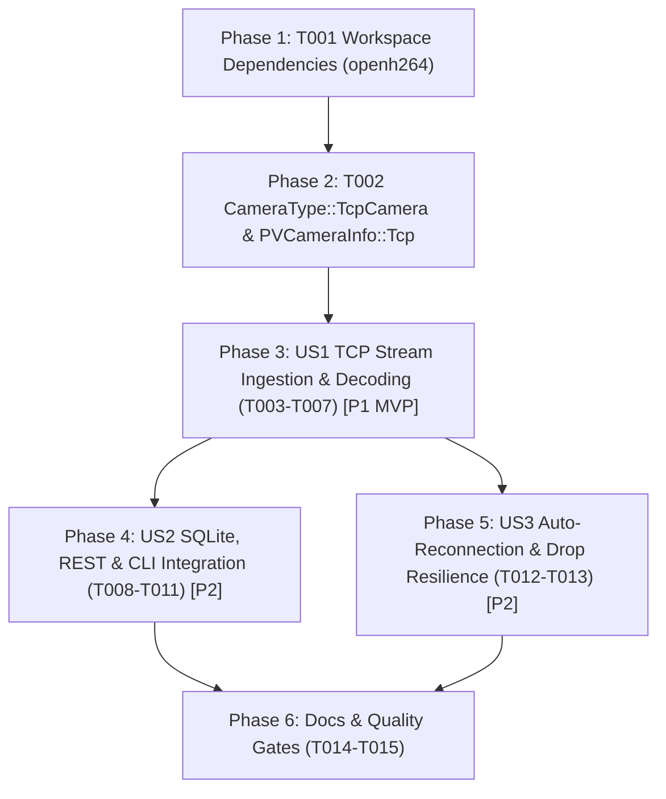

# Tasks: Local Network TCP Camera Stream Source (`rpicam-vid`)

**Input**: Design documents from `/specs/002-tcp-camera-source/`
**Prerequisites**: [`plan.md`](file:///home/rose/Documents/workspace_local/photonvision/specs/002-tcp-camera-source/plan.md) (required), [`spec.md`](file:///home/rose/Documents/workspace_local/photonvision/specs/002-tcp-camera-source/spec.md) (required for user stories), [`research.md`](file:///home/rose/Documents/workspace_local/photonvision/specs/002-tcp-camera-source/research.md), [`data-model.md`](file:///home/rose/Documents/workspace_local/photonvision/specs/002-tcp-camera-source/data-model.md), [`contracts/`](file:///home/rose/Documents/workspace_local/photonvision/specs/002-tcp-camera-source/contracts/)

**Tests**: Automated `cargo test` parity suites are MANDATORY per Constitution Principle V (`Test-Driven Parity & Benchmarking Discipline`) and Success Criteria `SC-001`–`SC-004`.

**Organization**: Tasks are grouped by user story (`US1`–`US3`) to enable independent implementation, verification, and incremental delivery of each story.

## Format: `[ID] [P?] [Story] Description`

- **[P]**: Can run in parallel (different files/crates, no dependencies on incomplete tasks)
- **[Story]**: Which user story this task belongs to (`[US1]`, `[US2]`, `[US3]`)
- Exact file paths under `fast-photon-core/` are included in every task description

## Path Conventions

- **Workspace Root**: `fast-photon-core/Cargo.toml`, `fast-photon-core/src/main.rs`
- **Configuration Sub-Crate**: `fast-photon-core/crates/photon-common/src/configuration/camera.rs`
- **Vision Sub-Crate**: `fast-photon-core/crates/photon-vision/src/camera/tcp.rs`, `fast-photon-core/crates/photon-vision/src/frame/provider.rs`, `fast-photon-core/crates/photon-vision/src/processes/vision_source_manager.rs`
- **Web Sub-Crate**: `fast-photon-core/crates/photon-web/src/handlers.rs`, `fast-photon-core/crates/photon-web/src/server.rs`
- **Integration Tests**: `fast-photon-core/tests/tcp_camera_stream_parity.rs`

---

## Phase 1: Setup (Workspace Dependencies)

**Purpose**: Add the in-process H.264 Annex-B decoder dependency (`openh264`) to the `fast-photon-core` workspace and `photon-vision` sub-crate.

- [X] T001 Add `openh264` dependency to workspace manifest in `fast-photon-core/Cargo.toml` and `fast-photon-core/crates/photon-vision/Cargo.toml`

---

## Phase 2: Foundational (CameraType & PVCameraInfo::Tcp Schema)

**Purpose**: Define `CameraType::TcpCamera` and `PVCameraInfo::Tcp` (`PVTcpCameraInfo`) in `photon-common` so both `photon-vision` and `photon-web` can reference the shared configuration types.

**⚠️ CRITICAL**: Must complete before User Stories 1–3.

- [X] T002 Add `CameraType::TcpCamera` and `PVCameraInfo::Tcp` (`"PVCameraInfo.PVTcpCameraInfo"` / `"PVTcpCameraInfo"`, default `1280×720 @ 30 FPS`) with helper constructors and accessors in `fast-photon-core/crates/photon-common/src/configuration/camera.rs`

**Checkpoint**: Shared `CameraType::TcpCamera` and `PVCameraInfo::Tcp` models are ready.

---

## Phase 3: User Story 1 - Connect to a Remote `rpicam-vid` TCP Camera Stream (Priority: P1) 🎯 MVP

**Goal**: Connect to a `rpicam-vid -t 0 --width 1280 --height 720 --framerate 30 --inline --listen -o tcp://0.0.0.0:8888` TCP endpoint (client mode by default, or `?listen=true` server mode), frame and decode inline H.264 Annex-B (`openh264`) and MJPEG (`image`) streams into `1280×720` `CVMat`/`Frame` instances with latest-frame semantics, and execute vision pipelines via `TcpCameraSource`.

**Independent Test**: Run `cargo test --test tcp_camera_stream_parity` to verify live TCP streaming (both H.264 Annex-B `--inline` and MJPEG) at `1280×720`, frame decoding into `CVMat`, and end-to-end target detection through a `VisionModule`.

### Tests for User Story 1 ⚠️

- [X] T003 [P] [US1] Create TCP stream decoding (H.264 Annex-B `--inline` & MJPEG) and `VisionModule` pipeline execution tests in `fast-photon-core/tests/tcp_camera_stream_parity.rs`

### Implementation for User Story 1

- [X] T004 [US1] Implement `TcpStreamEndpoint` parser (`tcp://<host>:<port>` outbound client default and `?listen=true` inbound listener mode) in `fast-photon-core/crates/photon-vision/src/camera/tcp.rs`
- [X] T005 [US1] Implement bounded (`8 MiB`) `TcpStreamDecoder` supporting auto-detected H.264 Annex-B (`--inline` SPS/PPS/IDR/slice NAL units via `openh264`) and MJPEG (`0xFF 0xD8`..`0xFF 0xD9` via `image`) decoding into `CVMat` in `fast-photon-core/crates/photon-vision/src/camera/tcp.rs`
- [X] T006 [US1] Implement `TcpFrameProvider`, `TcpCameraSettables`, and `TcpCameraSource` (decoupled background reader thread, latest-frame slot overwrite, and dynamic `1280×720` `FrameStaticProperties` resolution sync) in `fast-photon-core/crates/photon-vision/src/camera/tcp.rs`
- [X] T007 [US1] Export `tcp` camera module and `TcpFrameProvider` in `fast-photon-core/crates/photon-vision/src/camera/mod.rs` and `fast-photon-core/crates/photon-vision/src/frame/provider.rs`

**Checkpoint**: User Story 1 (live `rpicam-vid` TCP H.264/MJPEG stream ingestion and pipeline processing) is complete and independently testable.

---

## Phase 4: User Story 2 - Persist, Configure & Manage TCP Camera Sources via CLI, REST & SQLite (Priority: P2)

**Goal**: Support creating, saving, reloading, deactivating, and reactivating `CameraType::TcpCamera` modules via `VisionSourceManager`, `photon.sqlite`, REST (`POST /api/settings/camera/addTcpCamera` and `POST /api/utils/assignUnmatchedCamera`), and CLI (`--tcp-camera <URI>`).

**Independent Test**: Run `cargo test --test tcp_camera_stream_parity` to verify `photon.sqlite` persistence round-trip for `PVCameraInfo::Tcp`, `VisionSourceManager` activation/deactivation, and `POST /api/settings/camera/addTcpCamera` REST registration.

### Tests for User Story 2 ⚠️

- [X] T008 [P] [US2] Add SQLite persistence round-trip, `VisionSourceManager` lifecycle, and `POST /api/settings/camera/addTcpCamera` REST contract tests in `fast-photon-core/tests/tcp_camera_stream_parity.rs`

### Implementation for User Story 2

- [X] T009 [US2] Update `VisionSourceManager::load_vision_source_from_cam_config` to instantiate `TcpCameraSource` for `CameraType::TcpCamera` in `fast-photon-core/crates/photon-vision/src/processes/vision_source_manager.rs`
- [X] T010 [P] [US2] Implement `on_add_tcp_camera_request` handler and register `POST /api/settings/camera/addTcpCamera` route in `fast-photon-core/crates/photon-web/src/handlers.rs` and `fast-photon-core/crates/photon-web/src/server.rs`
- [X] T011 [P] [US2] Add repeatable `--tcp-camera <URI>` CLI flag to register TCP stream sources on startup in `fast-photon-core/src/main.rs`

**Checkpoint**: User Story 2 (SQLite, `VisionSourceManager`, REST API, and CLI registration for TCP cameras) is complete and independently testable.

---

## Phase 5: User Story 3 - Automatic Stream Reconnection & Drop Resilience (Priority: P2)

**Goal**: Detect broken TCP connections or read timeouts within `<= 1.0` second without panicking, report `is_connected() == false`, and automatically reconnect and resynchronize on the next `--inline` frame within `<= 2.0` seconds when the remote `rpicam-vid --listen` server restarts.

**Independent Test**: Run `cargo test --test tcp_camera_stream_parity` disconnect/reconnect resilience test by dropping the simulated `rpicam-vid` TCP server connection, verifying `is_connected()` transitions to `false`, accepting a new connection on the server port, and verifying `is_connected()` returns to `true` with new frames delivered.

### Tests for User Story 3 ⚠️

- [X] T012 [P] [US3] Add TCP server drop, late-join `--inline` resynchronization, and automatic reconnection test in `fast-photon-core/tests/tcp_camera_stream_parity.rs`

### Implementation for User Story 3

- [X] T013 [US3] Implement bounded connect/read timeouts, graceful disconnect detection, decoder state reset on reconnect, and automatic background retry loop in `fast-photon-core/crates/photon-vision/src/camera/tcp.rs`

**Checkpoint**: User Story 3 (automatic stream reconnection and drop resilience) is complete and verified.

---

## Phase 6: Polish & Cross-Cutting Quality Gates

**Purpose**: Update `fast-photon-core/README.md` with the new `rpicam-vid` TCP camera streaming guide and run all workspace formatting, linting, and parity test gates.

- [X] T014 [P] Document `rpicam-vid` TCP camera streaming usage (`--tcp-camera`, REST API, and `PVTcpCameraInfo`) in `fast-photon-core/README.md`
- [X] T015 Run full workspace formatting (`cargo fmt --all -- --check`), strict Clippy linting (`cargo clippy --workspace --all-targets --all-features -- -D warnings`), and full test suite (`cargo test --workspace`) per `specs/002-tcp-camera-source/quickstart.md`

---

## Dependencies & Execution Order

### Parallel Opportunities
- **Phase 3 (US1)**: `T003` (test scaffolding) can be written in parallel with `T004`–`T006`.
- **Phase 4 (US2)**: `T008` (REST/SQLite tests), `T010` (`photon-web` REST endpoint), and `T011` (`src/main.rs` CLI flag) touch separate crates/files and can run in parallel after `T009`.
- **Phase 4 & Phase 5**: `US2` (`T008`–`T011`) and `US3` (`T012`–`T013`) can be developed in parallel once `US1` (`T007`) is complete.

---

## Implementation Strategy

### MVP First (User Story 1)
1. Complete **Phase 1** (`T001`) and **Phase 2** (`T002`).
2. Complete **Phase 3 (User Story 1)** (`T003`–`T007`) — delivers working `TcpFrameProvider` and `TcpCameraSource` decoding `1280×720 @ 30 FPS` H.264 Annex-B (`--inline`) and MJPEG streams into `VisionModule`.
3. Validate `cargo test --test tcp_camera_stream_parity`.

### Full Delivery (User Stories 2 & 3 + Quality Gates)
4. Complete **Phase 4 (User Story 2)** (`T008`–`T011`) — wires `VisionSourceManager`, `POST /api/settings/camera/addTcpCamera`, and `--tcp-camera` CLI flag.
5. Complete **Phase 5 (User Story 3)** (`T012`–`T013`) — verifies automatic reconnection and `--inline` stream resynchronization.
6. Complete **Phase 6 (Polish)** (`T014`–`T015`) — updates `README.md` and passes all Constitution gates.
